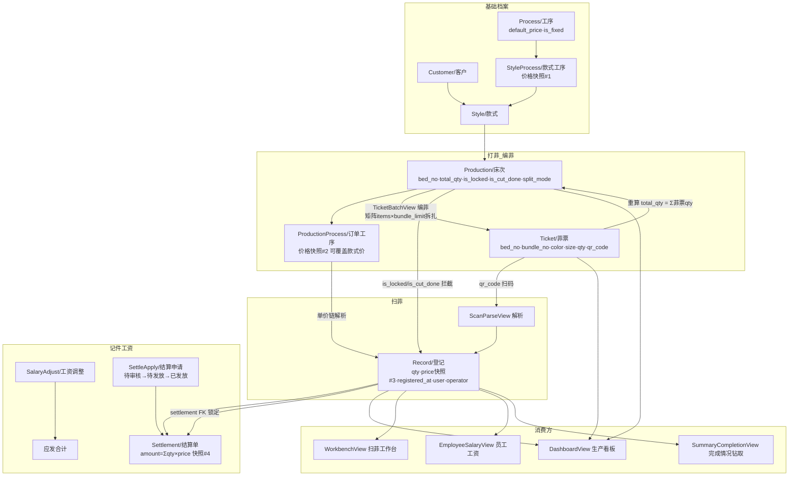

# 业务流程 ↔ 数据模型对应关系审计报告

> 审计日期：2026-10-18
> 范围：`backend/apps/{catalog,production,records,salary,accounts,ops,core}`（只读分析，未改任何代码）+ 前端 `frontend/pages/scan`、`frontend/packages`
> 参照：`backend/audit_chain.py` 已实际运行（连开发库，只读），结果：**0 ERROR / 1 WARN**（床次3 已裁完但菲票合计 160 < 裁货 300，种子数据问题）

---

## 一、结论先行

**总评：核心链路（款式 → 编菲 → 扫菲 → 计件结算 → 看板）的数据流向与代码实现基本一致，关键不变量（数量账、单价快照、结算锁定、完成+工作中恒等式）在正常单线程操作下均成立；但存在 2 个状态机语义矛盾（`is_cut_done` 同时拦截登记、`auto_cut_done` 开关打开后编菲直接不可用）、2 个无上限校验（登记超量、任意工序可登记）和 1 个删除残留口径问题（软删床次的菲票仍是活跃数据）。**

对账脚本实测：数量账、二维码唯一性、单价快照、看板 summary 五项、工资直算全部对平；唯一 WARN 是床次3 种子数据（已知待批）。

---

## 二、真实数据流图

### 2.1 全生命周期数据流（谁产生、谁消费）



### 2.2 实体关系（ER）

```mermaid
erDiagram
    Company ||--o{ Style : has
    Company ||--o{ Process : has
    Company ||--o{ Production : has
    Company ||--o{ Ticket : has
    Company ||--o{ Record : has
    Style ||--o{ StyleProcess : "工序配置(uq: style+process)"
    Process ||--o{ StyleProcess : referenced
    Style ||--o{ Production : "PROTECT"
    Production ||--o{ ProductionProcess : "订单工序(uq: production+process)"
    Process ||--o{ ProductionProcess : referenced
    Production ||--o{ Ticket : "CASCADE(uq: company+bed_no+bundle_no)"
    Ticket ||--o{ Record : "uq: company+ticket+process+user"
    Process ||--o{ Record : referenced
    User ||--o{ Record : "被登记人"
    User ||--o{ Record : "operator(协助人,SET_NULL)"
    Record }o--o| Settlement : "settlement FK(非空=已锁)"
    Company ||--o{ Settlement : has
    User ||--o{ SettleApply : applies
```

### 2.3 四次价格快照链（工资口径的关键）

| # | 快照点 | 位置 | 说明 |
|---|--------|------|------|
| 1 | StyleProcess.price | `catalog/models.py:124` | 款式工序价，保存时整表重建并汇总款式总单价（`catalog/views.py:69-73`） |
| 2 | ProductionProcess.price | `production/models.py:65` | 床次订单价，可覆盖款式价（`production/views.py:38-74` 全量替换） |
| 3 | Record.price（登记快照） | `records/views.py:122,137` | 登记时按「订单价>款式价>工序默认价」解析后固化，此后改价不影响（结算 WARN 监控比对） |
| 4 | Settlement.amount（结算快照） | `salary/views.py:462-475` | Σ(qty×record.price) 四舍五入到分，锁定后记录禁止改动/撤销（`records/views.py:178-179`） |

**结论：单价改动后已登记记录金额不变（登记时快照口径），实现正确。**

---

## 三、「流程步骤 ↔ 模型/接口」对照表

| 业务动作 | 入口页面/API | 写哪些表 | 状态变化 |
|---|---|---|---|
| 建款式+工序配置 | 款式页 → `POST /styles`（`catalog/views.py:112-143`） | style, style_process（物理重建）, style.price 重算 | 无 |
| 建床次（打菲第一步） | 生产页 → `POST /productions`（`production/views.py:184-206`） | production（total_qty 取入参）, production_process | is_cut_done 可被 auto_cut_done 置 True ⚠️ |
| 编菲/拆扎 | 编菲页 → `POST /tickets/batch`（`catalog/views.py:438-504`） | ticket 批量建（qr_code 由 `core/utils.py:23-34` 生成）, production.total_qty 重算 | 前置拦截：is_cut_done 禁加扎（449-450） |
| 打印菲票 | 打印队列 → `POST /tickets/print`（`catalog/views.py:534-564`） | ticket.print_count/is_printed/print_at | 无 |
| 删菲票 | `DELETE /tickets/<pk>`（`catalog/views.py:576-591`） | ticket 软删, total_qty 重算 | 前置：有登记禁删（586-587） |
| 扫码解析 | 扫菲页 → `POST /productions/scan-parse`（`production/views.py:475-531`） | 无（只读） | 返回 is_locked/is_cut_done 供前端拦截 |
| 扫菲登记 | 扫菲页 → `POST /records`（`records/views.py:83-148`） | record（price 快照） | 拦截：锁定(99)/裁完(101)/重登(131-133)/0价(124-127) |
| 协助登记 | 同上 + user_id（管理员） | record + audit_log(ASSIST) | 同上 |
| 撤销登记 | `DELETE /records/<pk>`（`records/views.py:151-188`） | record 软删 + audit_log(REVOKE) | 已结算禁撤(178-179)；本人限当日(165-169)；当月开关(173-177) |
| 锁定/解锁床次 | `PUT /productions/<pk>/lock`（`production/views.py:251-267`） | production.is_locked | 管理员专属，写日志 |
| 标记/取消裁完 | `PUT /productions/<pk>/cut-done`（`production/views.py:277-297`） | production.is_cut_done | ⚠️ 裁完会连带禁登记（见问题2） |
| 改订单工序/价 | `PUT /productions/<pk>/order-processes`（`production/views.py:348-382`） | production_process 物理重建 | 已登记记录价格不变（快照#3） |
| 结算 | `POST /salary/settlements`（`salary/views.py:432-485`） | settlement + record.settlement 批量圈占 | 记录锁定，条件圈占防双结(473-477) |
| 撤销结算 | `POST /salary/settlements/<pk>/revoke`（`salary/views.py:488-521`） | settlement.status=revoked, record.settlement 清空 | 已发放(有 PAID 申请重叠)禁撤(499-506) |
| 员工申请结算 | `POST /salary/settle-applies`（`salary/views.py:552-569`） | settle_apply（金额快照） | 待审核 |
| 审核/发放/作废 | `PUT .../review|pay|void`（`salary/views.py:593-688`） | settle_apply 状态机 + pay 时另建 settlement | PENDING→APPROVED→PAID |
| 离职 | `PUT /employees/<pk>/resign`（`accounts/views.py:289-305`） | user_company.status=RESIGNED | ⚠️ 未结清仅提示，force=1 可跳过 |

---

## 四、不变量核查表

| # | 不变量 | 结论 | 证据 | 影响 |
|---|---|---|---|---|
| 1 | 菲票 qty 合计 = 床次 total_qty | ✅（编菲/删票后自动重算）| `production/views.py:29-35`、`catalog/views.py:528-531,593-596` | ⚠️ 建床时 total_qty 为手填初始值，编菲前二者可不等（audit 实测床次3：160<300，WARN） |
| 2 | 颜色×尺码矩阵 ↔ 拆扎一致性 | ✅ | 矩阵即编菲 items 本身，拆扎按 bundle_limit 整除+尾扎（`catalog/views.py:484-488`），矩阵视图按菲票聚合（`production/views.py:443-472`） | 无独立"计划数量"，多裁/少裁不可检测（见待确认 #3） |
| 3 | 扎号公司内唯一（床次+扎号） | ✅ | DB 约束 `catalog/models.py:168-171` + 冲突顺延 `_alloc_bundle_no`（`catalog/views.py:521-526`，含软删行 all_objects 校验） | 软删票占用扎号导致跳号（可接受） |
| 4 | 菲票二维码唯一 | ✅（实测 351 张 0 重复） | qr = 公司号\|床次\|款号\|扎号\|色\|码\|数（`core/utils.py:23-34`），扎号唯一⇒码唯一；无 DB 约束兜底 ⚠️ | 手工改库才会撞；建议补唯一约束 |
| 5 | 软删后唯一约束不撞 | ⚠️ 依赖前置 purge | 10 处同族约束无 is_deleted 条件（Style `catalog/models.py:103`、Process:73、Customer:46、CustomerGroup:21、StyleProcess:133、Ticket:169、Production `production/models.py:47`、ProductionProcess:73、Record `records/models.py:44-47`、UserCompany `accounts/models.py:133`）；所有 create 路径均有 `_purge_deleted`/顺延/复活逻辑 | 逻辑上不会撞，但 (a) 同键重建会物理清除软删审计行；(b) 并发创建仍可能 IntegrityError 500（exists+create 无锁，如 `production/views.py:190-201`）；Post 已示范正确写法（`accounts/models.py:87-89` 条件约束） |
| 6 | 锁定后不能登记 | ✅ | `records/views.py:99-100` | — |
| 7 | 裁完后不能加扎 | ✅ | `catalog/views.py:449-450` | — |
| 8 | 裁完后不能登记 | ✅（实现如此）| `records/views.py:101-102` | ⚠️ **与模型注释矛盾且存疑**（见问题2） |
| 9 | 登记不超扎数 | ❌ **无上限校验** | `records/serializers.py:41` 仅 min_value=1；`records/views.py:121` qty 默认=整扎数；多员工各可登整扎 | 同扎同工序累计登记可 N 倍于扎数；audit_chain.py:81-82 有 ERROR 监控（当前库无） |
| 10 | 登记工序 ∈ 该扎工序集 | ❌ **不校验** | `records/views.py:104-107` 仅校验工序属本公司；价格可解析（>0）即放行（122-127） | 可登记床次/款式均未配置的工序 → 完成口径被撑爆、工资多付；audit_chain.py:77-80 WARN 监控（当前库无） |
| 11 | 重复扫码防重 | ✅ | DB 唯一约束 `records/models.py:44-47` + 显式校验 `records/views.py:131-133` | 副作用：同扎同工序同人不能增量补登，须撤销重登（registered_at 变为新时刻，影响月度归属） |
| 12 | 单价链：订单价>款式价>默认价 | ✅（一处细节⚠️） | `records/views.py:27-39` | 订单价显式为 0 时会被跳过回退到款式价（`if pp and pp.price`），且 0 价一律拒绝登记（124-127）→ "本床该工序免费"无法表达 |
| 13 | 改价不影响已登记金额 | ✅ | 登记快照 `records/views.py:122,137`；结算 Σ(qty×record.price) `salary/views.py:87-90` | audit WARN 仅做现价比对提示 |
| 14 | 结算后记录不可改/撤 | ✅ | `records/views.py:178-179`；圈占条件 update `salary/views.py:473-477` | ⚠️ 发放路径 `_pay` 的 update 未带 settlement__isnull 条件（`salary/views.py:649`），并发窗口可覆盖（见问题7） |
| 15 | 完成+工作中 = 范围内登记数 | ✅ 结构性恒等 | `production/views.py:651-661`：每个 (床次,菲票) 聚合行必进 done 或 working 恰一支（pc=0 归 working） | 所有 range 均成立（today/week/month/custom 共用 range_records 派生） |
| 16 | 已裁合计 = 各色行已裁之和（2026-10-17 拍板口径） | ✅ | `production/views.py:737-743,763-766`：cut_total = Σ各色行 cut_qty | 混色床整床计入每个色行，款级合计数值上可超实际裁货（口径已知，建议 UI 注明） |
| 17 | 完成判定 = distinct 工序数 ≥ 配置数 | ✅（一处漏守卫） | 主口径 `production/views.py:121-122,657-658` 均有 `pc and` 守卫；`catalog/views.py:99`、`production/views.py:414` 同 | ❌ `records/views.py:249` WorkbenchView 的 `if row['pn'] >= pc_map[pid]` 无 pc>0 守卫 → 无任何工序配置的床次，有登记即算"完成" |
| 18 | 离职需结清 | ⚠️ 仅提示不强制 | `accounts/views.py:290-299`：force=1 可带未结清离职 | 且离职后工资页查不到（见问题13） |
| 19 | 看板对账（API vs DB） | ✅ 实测一致 | audit_chain.py 环节5：summary 五项（登记/经手菲票/在产床次/裁货总量/订单总量）全对平 | — |

---

## 五、问题清单（按严重度排序）

### A 级：会导致数据错 / 功能不可用

**A1. `auto_cut_done` 开关自相矛盾：打开后编菲直接不可用**
- 语义：`ops/models.py:26`「默认裁完：编菲后自动置裁完」
- 实现：建床时即置 `is_cut_done=auto_cut_done`（`production/views.py:196-201`），而编菲前置拦截 is_cut_done 禁加扎（`catalog/views.py:449-450`）
- 后果：开关打开 → 建床即裁完 → 编菲接口 400，整个打菲流程走不通；测试脚本也专门绕过此开关（`wave2_regression.py:39-40` 注释承认"会把新床次直接标记裁完，阻塞"）
- 建议：改为在 `TicketBatchView` 成功后置 is_cut_done，或明确开关语义
- **【已修复 2026-10-18】** 建床不再置 is_cut_done；编菲（TicketBatchView）成功后若 `auto_cut_done` 开启则自动置裁完（`catalog/views.py`），系统无裁剪类工序标识，按拍板采用人工标记+开关兜底语义；模型注释同步改写为「裁完=裁剪完成标记，不拦截登记/加扎」

**A2. 登记数量无上限（超量登记）**
- `records/serializers.py:41`（仅 min_value=1）、`records/views.py:121-137`（无 qty ≤ ticket.qty 校验）
- 且唯一约束粒度是 (票,工序,人)，N 个员工各登整扎 → 累计 = N×扎数
- 影响：工资按登记直发，超量=多付钱；目前仅靠 audit_chain 事后 ERROR 发现
- 建议：create 时校验 Σ(同票同工序各人 qty) ≤ ticket.qty（分货模式 BY_PROCESS 时按工序分摊上限另定，见待确认 #4）
- **【已修复 2026-10-18】** create/增量登记均在事务内对菲票行 `select_for_update` 后校验 Σ(同票同工序全员) + 本次 ≤ ticket.qty，超出 400「登记数量超限」（`records/views.py`）；同扎同工序同人改为增量补登（qty 累加进同一条 Record，price 快照沿用首次）

**A3. 登记工序不校验是否在床次/款式工序集**
- `records/views.py:104-107` 只查"工序存在本公司"；工序选择器只影响默认选项（`records/views.py:191-223`），非硬约束
- 影响：可登记未配置工序 → 完成扎判定（pn≥pc）被无关工序干扰、工资多付；与 A2 叠加风险放大
- 建议：默认仅允许 ProductionProcess ∪ StyleProcess 中的工序（放行需管理员+审计日志）
- **【已修复 2026-10-18】** 登记硬校验工序 ∈ 床次工序集（ProductionProcess 集合，为空回退 StyleProcess 集合，两者皆空则不限制），不在集合内 400「不在床次【X】的工序配置中」（`records/views.py::_process_config`）

**A4. 软删床次的菲票仍是"活跃"数据（删除残留）**
- `production/views.py:239-248`：删床次仅软删 Production 本身（`core/models.py:33-36` 只标记自身），其下 ticket 全部保持 is_deleted=False
- 波及：`TicketListView`（`catalog/views.py:424-435` 无 production__is_deleted 过滤）、看板 order_total（`production/views.py:678-679`）、款式统计 attach_style_stats（`catalog/views.py:81-85`）、颜色/尺码提示接口（`production/views.py:321-345`）全部继续计入已删床次的菲票
- 建议：删床次时级联软删其菲票，或所有票查询加 production__is_deleted=False
- **【已修复 2026-10-18】** 采用级联方案：perform_destroy 同事务内 `Ticket.filter(production=instance).update(is_deleted=True)` + 软删 Production（`production/views.py::perform_destroy`），查询侧无需逐处加过滤

### B 级：口径不符 / 语义存疑

**B1. `is_cut_done` 拦截全部扫菲登记，与注释矛盾**
- 模型注释：「裁完：标记该床次裁货完成，之后不允许增加扎数」（`production/models.py:11-12`）、`ProductionCutDoneView` 文档同样只提加扎（`production/views.py:278`）
- 实现却整体禁登记（`records/views.py:101-102`）。按真实厂务，裁完（裁剪完成）发生在车缝/尾部扫菲**之前**——若语义是"裁剪完成"，标记后车间反而不能扫码，属业务性阻断
- 已列入待确认 #1
- **【已修复 2026-10-18】** 拍板为 (a) 裁剪完成：is_cut_done 不再拦截登记（`records/views.py`），编菲加扎拦截同步移除，前端扫码页提示同步删除；is_cut_done 现为纯状态标记

**B2. `_pay` 结算圈占不对称，并发下可二次结算**
- `_settle` 用条件 update + claimed 校验（`salary/views.py:473-477`）；`_pay` 的 `Record.objects.filter(pk__in=records.values('pk')).update(settlement=...)` 未再校验 settlement__isnull=True（`salary/views.py:649`）
- 并发窗口：exists/sum 求值与 update 之间，若另一张全员结算单圈占了同批记录，_pay 会直接覆盖 settlement FK → 两个结算单金额与实际锁定记录错位

**B3. 公司工资汇总 settled 可重复计数**
- `salary/views.py:111-116` 按结算单期间与查询区间重叠即求和：全员结算后再做个别/小周期结算（记录不重叠、不会双锁），但 settled 显示值会双计；且把期间外登记的金额也计入
- 建议：settled 改由 record.settlement FK 聚合（与 unsettled 同口径）

**B4. 款式统计与床次统计的"完成"口径不一致**
- 款式 done 用款式工序数（`catalog/views.py:86-100`）；床次 done 用订单工序优先（`production/views.py:109-122`）
- 订单覆盖工序配置时，同一扎在款式页"未完成"、床次页"完成"

**B5. WorkbenchView pc=0 漏守卫（完成误判）**
- `records/views.py:236-249`：`if row['pn'] >= pc_map[pid]`，当床次既无订单工序又无款式工序（pc=0）时，任何登记都判"完成"；同文件其余三处口径均有 `pc and` 守卫

**B6. "范围内裁货数"按建床时间统计**
- `production/views.py:663-668` 用 Production.created_at；晚于建床的编菲加扎、跨月完成裁剪都会归期错位

**B7. 撤销登记不校验锁定/裁完状态**
- `records/views.py:163-188`：只校验结算/当月/本人，未查 production.is_locked / is_cut_done → 锁定床次（防错登场景）的记录仍可被撤销
- **【未修复，保留观察】** 本批未改动（拍板清单未含）；撤销=整条记录扣减（软删该行），部分撤销需历史列（DDL 未授权）

**B8. 协助登记不校验目标用户是本公司成员**
- `_resolve_target_user` 全局取 User（`records/views.py:42-50`）；仅当 `forbid_unapproved_register` 开启时查 UserCompany（111-115），默认关闭时可给任何系统用户登记（记录落在本公司，工资页按 company+user 过滤会显示）
- **【已修复 2026-10-18】** 协助登记硬拦截：目标用户必须是本公司 ACTIVE 成员，否则 400「该员工不是本公司在职成员，禁止协助登记」（`records/views.py`）

### C 级：潜在风险

**C1. 唯一约束族（10 处）依赖运行时 purge**：见不变量 #5；建议参照 `accounts/models.py:87-89` 改为 `condition=Q(is_deleted=False)` 部分约束，并保留 purge 兼容
**C2. 编菲/建床并发创建可 IntegrityError 500**：exists→create 无锁（`production/views.py:190-201`、`catalog/views.py:136-138`）
**C3. 扫码解析不校验 QR 冗余段与库一致**：`production/views.py:495-499` 只用 bed_no+bundle_no 定位，style/color/size/qty 段不比对（当前无票编辑入口，风险低）
**C4. 订单工序全量替换影响历史完成判定**：`production/views.py:71-74` 物理重建后，pc 变化会追溯改变已登记菲票的"完成"状态（有 PROCESS 审计日志可查）
**C5. 工序顺序不强制**：Process.sort 仅展示排序（`catalog/models.py:65,71`）；扫菲可任意顺序、任意跳工序（前端 `frontend/pages/scan/index.ts` 同样无顺序约束）→ 待确认 #2
- **【部分修复 2026-10-18】** 拍板方案：StyleProcess 加 `allow_skip`（BooleanField 默认 True，前端工序单价配置页加「跳序」开关）；登记时若存在 sort 更小、未完成且 allow_skip=False 的已配置工序则 400「需先完成工序【X】」（`records/views.py`）；完全自由顺序在全部 allow_skip=True（默认）时保持不变

---

## 六、待用户确认（业务规则，不猜）

1. **「裁完」的业务语义到底是什么？** (a) 裁剪完成（之后车间还要扫码）→ 当前 `records/views.py:101-102` 禁登记是 bug；(b) 整单生产完结（之后确实无需扫码）→ 实现正确但模型注释需改。若为 (b)，`auto_cut_done`（A1）也才有合理解释——请一并确认该开关预期行为。 **〔已拍板 2026-10-18：= (a) 裁剪完成，已按此实施，见 A1/B1 标注〕**
2. **是否需要强制工序顺序（如 裁剪→车缝→尾部）？** 当前完全自由顺序、可跳工序。若需强制，需在 Process 上加顺序号并在登记时校验前置工序。 **〔已拍板 2026-10-18：按 StyleProcess.allow_skip 按工序禁跳，默认 True，见 C5 标注〕**
3. **床次是否有"计划裁货数量"概念？** 当前 total_qty 完全由菲票汇总反推，编菲数量无上限、无少裁/多裁告警（audit 只查"已裁完且菲票<裁货"这种 seed 矛盾）。是否需要「下单数量 vs 实裁数量」两本账？ **〔已拍板 2026-10-18：Production 加 plan_qty（可空），建床录入、详情展示，与实裁分账；看板本批不消费〕**
4. **「分工序分摊」(split_mode=BY_PROCESS) 的分摊规则？** 模型有该字段（`production/models.py:20-22,35-36`）且可设置（`production/views.py:300-318`），但除 ScanParseView 透传给前端（524）外，**后端没有任何逻辑消费它**——登记数量上限、分摊校验均未实现。当前该字段是死配置。 **〔已拍板 2026-10-18：split_mode 彻底删除（模型/序列化器/接口/前端），登记上限统一按 (票,工序) 累计 ≤ 扎数〕**
5. **同扎同工序同一人能否增量补登？** 当前唯一约束一刀切：一次登记=整扎（qty 默认=扎数），分几天做完一件扎的活必须撤销重登（时间会变成撤销当天，影响月度工资归属）。实际厂里是否需要「部分完成、多次扫码」？ **〔已拍板 2026-10-18：允许，同票同工序同人累加进同一条 Record（qty 累加、registered_at 更新、price 沿用首次快照）〕**
6. **离职未结清是否必须强制结清？** 当前仅弹提示可 force 跳过（`accounts/views.py:296-299`），且离职后「员工薪酬卡」「员工工资明细」接口都查不到此人（`salary/views.py:172-175,313-315` 仅 ACTIVE）→ 离职员工的未结工资在管理端成为盲区，是否需要离职员工工资查询/自动结清？ **〔已拍板 2026-10-18：有未结算记录一律 400（force 通道删除）；离职员工工资管理端可查（ACTIVE+RESIGNED）〕**
7. **混色床的"已裁数量/已裁合计"口径**（整床计入每个色行、款级合计=各色行之和，2026-10-17 已拍板）确认维持不变？数值上款级合计可大于实际裁货总数，UI 是否需标注？ **〔已确认 2026-10-18：维持不标注，无需改动〕**
8. **协助登记给非本公司用户**是否需要硬拦截（当前默认放行，见 B8）？ **〔已拍板 2026-10-18：需要，非本公司 ACTIVE 成员一律 400，见 B8 标注〕**

---

## 七、改进建议（不改代码，仅建议）

1. **登记校验补强**（对应 A2/A3）：create 时事务内校验 `Σ同票同工序 qty ≤ ticket.qty` 与工序 ∈ 床次/款式配置集；BY_PROCESS 模式按确认后的分摊规则另行校验。
2. **状态机统一**：is_cut_done/is_locked 的拦截点集中到一个方法（如 `production.assert_can_register()`），消除"注释说只拦加扎、代码全拦"的漂移；auto_cut_done 移到编菲成功后。
3. **删除级联**：软删床次时级联软删菲票（或查询侧统一加过滤），消除 A4 的口径漂移。
4. **唯一约束改造**：10 处同族约束加 `condition=Q(is_deleted=False)`（Post 已示范），purge 逻辑保留过渡；Ticket.qr_code 补 DB 唯一约束。
5. **结算并发对齐**：`_pay` 的 update 加 `settlement__isnull=True` 条件并校验 claimed 数，与 `_settle` 对称。
6. **settled 口径**：公司汇总的 settled 改为按 `record.settlement` FK 聚合，天然防重叠双计。
7. **完成口径统一**：款式/床次/工作台/看板四处统一走「订单工序优先」一个 helper；WorkbenchView 补 pc>0 守卫。
8. **事后对账常态化**：audit_chain.py 已覆盖数量账/二维码/超量/未配置工序/看板对账，建议加：登记累计 vs 扎数（按票×工序跨人多用户汇总，当前只查单人单条）、离职员工未结金额、软删床次活跃菲票三项，并定期（如每周）跑一次。

---

## 附录：audit_chain.py 实测输出摘要（2026-10-18）

```
公司 辉腾制衣（演示）(100001)：款式43 · 床次15 · 菲票351 · 登记13
  [WARN] 床次→菲票: 床次3 已裁完但菲票合计 160 < 裁货 300   ← 种子数据，已知待批
  [OK] 菲票字段 351 张（二维码 0 重复、字段一致）
  [OK] 登记→菲票 13 条（无跨厂/无超量/无未配置工序/单价快照一致）
  [OK] 看板对账 summary 五项与数据库一致
  [OK] 工资对账一致
其余两演示公司：空数据，全部 OK。汇总：0 ERROR / 1 WARN
```

静态分析与对账结果无矛盾；对账脚本未覆盖的盲区（跨用户累计超量、软删床次活跃票、离职未结）已列入第七节建议 8。

---

## 九、2026-10-18 修复实施记录（第二批拍板 8 项落地）

**迁移（均已 migrate）**
- `catalog/migrations/0004_styleprocess_allow_skip.py`：StyleProcess.allow_skip（BooleanField 默认 True）
- `production/migrations/0002_remove_production_split_mode_production_plan_qty.py`：删 split_mode、加 plan_qty（PositiveIntegerField 可空）
- 除此之外无任何表结构变更（拍板授权范围外零 DDL）

**关键设计决策**
1. 「裁完」= 裁剪完成（纯状态）：建床不再置 is_cut_done；`auto_cut_done` 开启时在编菲（TicketBatchView）成功后自动置裁完——系统无裁剪类工序标识，无自动判定依据，按拍板采用该兜底；登记/加扎/撤销均不再被 is_cut_done 拦截。
2. 登记上限口径 = (菲票, 工序) 跨全员累计 ≤ ticket.qty：事务内对菲票行 select_for_update 串行化，覆盖 A2 的 N 人各登整扎漏洞；超出 400 并报已登/本次/扎数三个数。
3. 增量补登：同 (票,工序,人) 再登记累加进同一条 Record（qty+=、registered_at=本次、price 沿用首次快照），撤销仍为整行软删扣减——部分撤销需历史列（DDL 未授权，未做）。
4. 工序集校验回退链：ProductionProcess 集合 → 为空回退 StyleProcess 集合 → 两者皆空不限制；跳序校验只看已配置工序（allowed ∩ StyleProcess）中 sort 更小、未完成且 allow_skip=False 者。
5. A4 采用级联软删：删床次同事务软删其全部菲票，查询侧零改动。
6. 离职：有未结算记录一律 400（need_confirm/force 通道删除）；离职员工工资 ACTIVE+RESIGNED 均可查。

**验证结果（全部两连跑幂等）**
- 五套件：e2e_fullchain 111 / wave2_regression 53 / e2e_edge 24 / e2e_branches 54 / trust_verify 10 —— 全绿
- 新增 `backend/audit_fixes.py`：8 大领域 34 项检查 × 2 轮全过
- `contract_check.py`：后端 99 路由，前端未匹配 0
- 前端 `tsc --noEmit`：0 错误
- 服务重启后 curl 抽查：plan_qty 建床写入/PUT 更新均生效；split-mode 接口 404；超量登记 400「登记数量超限」；登录/撤销正常

**前端改动**
- 工序单价配置页加「跳序」开关（allow_skip）；建床页加「计划裁货」输入、详情页加展示；split_mode 全删；扫码页删除「订单已裁完，禁止登记」拦截
